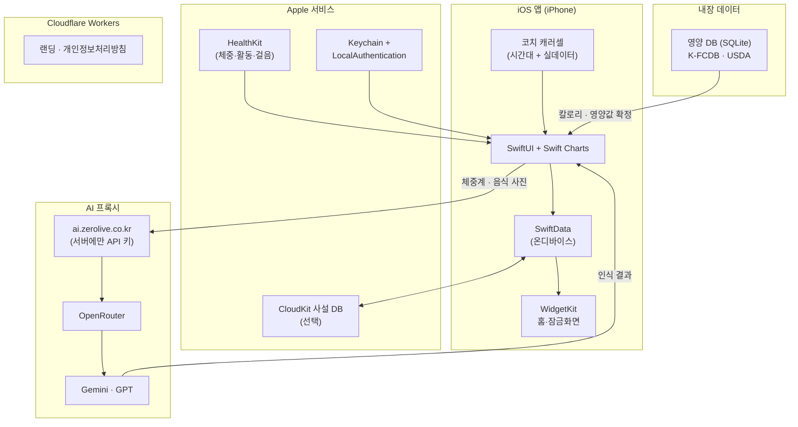

# 햄찌 다이어트

🌐 **Language**: [한국어](./README.md) | [English](./README_EN.md)

> 체중계·음식 사진을 찍으면 AI가 알아서 기록하는 iOS 다이어트 앱

---

## 개요

**햄찌 다이어트**는 기록의 번거로움을 없앤 iOS 다이어트 앱입니다. 디지털 체중계 화면이나 음식 사진을 찍으면 AI가 숫자와 메뉴를 읽어 대신 입력합니다. 먹은 칼로리에서 애플 건강의 활동 소모를 빼 "오늘 실제 칼로리"를 보여주고, 연간·월간·단기 목표를 겹쳐 세울 수 있습니다. 목표를 만들면 시작 체중에서 목표까지가 여러 단계로 나뉘고 등록해 둔 보상이 각 단계에 무작위로 숨겨집니다. 기록은 기기에 저장하며, 원하면 iCloud로 내 기기끼리만 동기화합니다. 마스코트 햄찌가 시간대와 기록 상황에 맞춰 코칭 카드를 띄웁니다.

---

## 주요 기능

### 사진으로 기록하는 체중·식사
- 디지털 체중계 화면을 촬영하면 AI가 숫자를 읽어 기록, 인식 실패 시 직접 입력으로 전환
- 음식 사진을 항목별로 인식하고, 칼로리·영양값은 내장 공공 DB(K-FCDB·USDA)에서 확정
- 화면에 영양값 출처를 함께 표기

### 실제 칼로리 (칼로리 in-out)
- 섭취 칼로리에서 애플 건강의 활동 소모를 뺀 오늘의 실제 칼로리 표시
- 매주 체중 변화에 맞춰 목표 칼로리 재계산
- 키·나이·성별·체지방률 기반 BMR/TDEE 산출 (Mifflin-St Jeor, 체지방률이 있으면 Katch-McArdle)

### 다중 목표 · 마일스톤 · 셀프 보상
- 연간·월간·단기 목표를 동시에 운영
- 시작 체중에서 목표까지 2~8단계로 자동 분할
- 등록한 보상이 각 단계에 무작위로 배치되어 도달 시 공개

### 홈·잠금화면 위젯
- 오늘 요약 · 빠른 기록 · 오늘 칼로리 · 목표 달성률 · D-day 제공
- 앱이 App Group에 남긴 요약값만 읽어 위젯은 네트워크를 사용하지 않음
- 위젯을 누르면 `hamzzi://` 딥링크로 해당 화면 진입

### 코치 캐러셀
- 시간대와 실데이터(연속 기록·걸음·섭취·마일스톤 근접)로 코칭 카드를 동적 생성
- 홈 화면에서 순환 표시하며 논문 근거를 함께 제공

### 추이 분석 · 알림
- Swift Charts 기반 체중 추이 그래프와 규칙 기반 특이점 알림
- 식사시간·체중 측정 리마인더, 치어업 푸시, 명절 알림을 실데이터 기반 문구로 재등록

### 보안 · 데이터 주권
- 핀 번호(기본) + 생체인증(보조) 앱 잠금, 핀은 Keychain에 해시로 저장
- iCloud 동기화는 기본 꺼짐, 켜면 CloudKit 사설 DB로 내 기기끼리만 동기화
- 애플 건강에서 읽은 체지방률은 동기화 대상에서 제외
- 기록을 CSV·JSON으로 내보내기, 앱 안에서 개인정보처리방침·데이터 삭제 제공

### AI 크레딧 · 리워드 광고
- 무료 AI 사용량을 크레딧으로 관리하고 광고 시청으로 충전 (과금 없음)
- AdMob 3종(리워드·네이티브·앵커드 배너) 연동, App Tracking Transparency 대응

---

## 기술 스택

| 분류 | 기술 |
|------|------|
| **UI** | SwiftUI, Swift Charts, iOS 17+ (iPhone 전용) |
| **데이터** | SwiftData (온디바이스), CloudKit 사설 DB (선택) |
| **위젯** | WidgetKit, App Group 공유 스냅샷 |
| **AI 인식** | 자체 프록시 경유 OpenRouter (Gemini · GPT) |
| **건강** | HealthKit (체중·활동 소모·걸음·체지방 read) |
| **알림** | UserNotifications (로컬 알림) |
| **보안** | LocalAuthentication, Keychain |
| **광고** | Google Mobile Ads (AdMob), App Tracking Transparency |
| **랜딩** | Cloudflare Workers |
| **빌드** | XcodeGen (`project.yml` → `.xcodeproj` 생성) |

---

## 아키텍처

---

## 개발 과정에서의 도전과 해결

### 1. AI 인식값의 신뢰도 확보
**도전**: 음식 사진을 AI로 분석하면 메뉴는 그럴듯하게 읽어내지만, 칼로리와 영양값은 호출할 때마다 달라져 기록의 근거로 쓰기 어려웠습니다.

**해결**: AI의 역할을 사진 속 음식 항목을 알아보는 것까지로 제한하고, 실제 칼로리·영양값은 앱에 내장한 공공 영양 DB(K-FCDB·USDA)에서 확정하도록 분리했습니다. 화면에 출처를 함께 표기해 사용자가 값의 근거를 확인할 수 있게 했습니다.

### 2. 앱에 API 키를 두지 않는 AI 호출
**도전**: 클라이언트 앱에 AI API 키를 넣으면 추출될 위험이 있고, 사용량 제어도 불가능했습니다.

**해결**: 자체 프록시(`ai.zerolive.co.kr`)를 거치도록 구성하고 실제 키는 서버에만 두었습니다. 앱 번들에는 프록시 주소와 앱 전용 토큰만 담고, 사진은 인식하는 순간에만 전송하며 서버에 남기지 않습니다. 전송 전 앱에서 동의를 받습니다.

### 3. 기록이 끊기는 이탈 구간
**도전**: 다이어트 앱은 초반 며칠 뒤 기록이 끊기기 쉬워, 단순한 목표 달성률 표시만으로는 동기가 유지되지 않았습니다.

**해결**: 목표를 만들면 시작 체중부터 목표까지가 2~8단계로 자동 분할되고, 사용자가 등록한 보상이 각 단계에 무작위로 숨겨지도록 했습니다. 여기에 시간대·연속 기록·걸음·마일스톤 근접도를 조합해 코칭 카드를 동적으로 생성하고, 로컬 알림 문구도 실데이터 기반으로 다시 등록되게 했습니다.

### 4. 위젯의 응답 속도와 배터리
**도전**: 홈·잠금화면 위젯이 갱신될 때마다 데이터를 다시 계산하거나 네트워크를 호출하면 표시가 느려지고 배터리 소모가 커집니다.

**해결**: 앱이 기록 변경 시점에 요약값을 App Group에 저장하고, 위젯은 그 스냅샷만 읽도록 했습니다. 위젯은 네트워크를 사용하지 않으며, 탭하면 `hamzzi://` 딥링크로 해당 화면에 바로 진입합니다.

---

## 역할 및 기여

- iOS 앱 아키텍처 설계 및 SwiftUI + SwiftData 구현
- 체중계·식사 사진 AI 인식 파이프라인 설계 (AI 인식 + 공공 DB 확정 분리)
- AI 프록시 경유 호출 구조 및 크레딧·리워드 광고 시스템 구현
- HealthKit 연동 칼로리 in-out 및 BMR/TDEE 산출 로직 개발
- 다중 목표·마일스톤·셀프 보상 시스템 설계
- WidgetKit 홈·잠금화면 위젯 및 App Group 스냅샷 공유 구현
- CloudKit 선택적 동기화, 핀·생체 앱 잠금, 데이터 내보내기 개발
- Cloudflare Workers 랜딩 페이지 구축 및 App Store 심사 대응(ATT)·배포

---

## 관련 링크

- **GitHub**: [leonardo204/HamzziDiet](https://github.com/leonardo204/HamzziDiet)
- **App Store**: [햄찌 다이어트](https://apps.apple.com/app/id6806743562)
- **소개 페이지**: [hamzzi-diet.zerolive.co.kr](https://hamzzi-diet.zerolive.co.kr)
- **Contact**: zerolive7@gmail.com

---

*햄찌 다이어트는 기록을 사진 한 장으로 줄이고, 마일스톤과 셀프 보상으로 다이어트를 이어가도록 돕는 iOS 앱입니다.*
