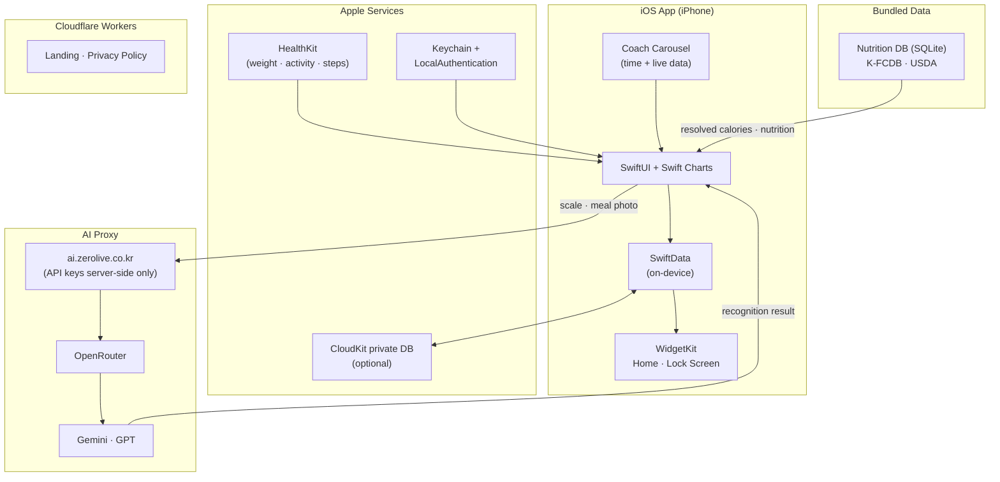

# HamzziDiet

🌐 **Language**: [한국어](./README.md) | [English](./README_EN.md)

> An iOS diet app that logs for you — just photograph your scale or your meal

---

## Overview

**HamzziDiet** removes the friction from diet logging. Photograph a digital scale display or a meal, and AI reads the number or identifies the dishes and fills the entry in for you. It subtracts Apple Health activity burn from your intake to show today's net calories, and lets you stack annual, monthly, and short-term goals at the same time. When you create a goal, the path from your starting weight to the target is split into stages, and rewards you registered are hidden at random stages along the way. Records are stored on device, with optional CloudKit sync limited to your own devices. The mascot Hamzzi surfaces coaching cards based on the time of day and your actual logging activity.

---

## Key Features

### Photo-Based Weight & Meal Logging
- Photograph a digital scale display and AI reads the number; falls back to manual entry when recognition fails
- Meal photos are recognized dish by dish, while calories and nutrition values are resolved from a bundled public database (K-FCDB · USDA)
- Data sources are shown on screen alongside the values

### Net Calories (Calories In-Out)
- Shows today's net calories by subtracting Apple Health activity burn from intake
- Recalculates the calorie target weekly based on actual weight change
- Derives BMR/TDEE from height, age, sex, and body fat (Mifflin-St Jeor, or Katch-McArdle when body fat is available)

### Multiple Goals · Milestones · Self-Rewards
- Run annual, monthly, and short-term goals in parallel
- The range from starting weight to target is automatically split into 2–8 stages
- Registered rewards are placed at random stages and revealed on arrival

### Home & Lock Screen Widgets
- Today's summary, quick logging, today's calories, goal progress, and D-day
- Widgets read only the summary snapshot the app writes to an App Group, so they make no network calls
- Tapping a widget opens the matching screen via a `hamzzi://` deep link

### Coach Carousel
- Coaching cards generated dynamically from time of day and live data (logging streak, steps, intake, milestone proximity)
- Rotated on the home screen with supporting research references

### Trend Analysis & Notifications
- Weight trend charts built on Swift Charts with rule-based anomaly alerts
- Meal-time and weigh-in reminders, cheer-up pushes, and holiday notifications re-registered with wording drawn from actual data

### Security & Data Ownership
- App lock with a PIN (primary) and biometrics (secondary); the PIN is stored as a hash in Keychain
- iCloud sync is off by default; when enabled, records sync through a CloudKit private database across the user's own devices only
- Body fat values read from Apple Health are excluded from sync
- Records export to CSV and JSON; the privacy policy and data deletion are available inside the app

### AI Credits & Rewarded Ads
- Free AI usage is managed as credits and topped up by watching ads (no in-app purchases)
- Three AdMob formats (rewarded, native, anchored banner) integrated, with App Tracking Transparency handling

---

## Tech Stack

| Category | Technology |
|----------|------------|
| **UI** | SwiftUI, Swift Charts, iOS 17+ (iPhone only) |
| **Data** | SwiftData (on-device), CloudKit private DB (optional) |
| **Widgets** | WidgetKit, App Group shared snapshot |
| **AI Recognition** | OpenRouter (Gemini · GPT) via a self-hosted proxy |
| **Health** | HealthKit (weight, active energy, steps, body fat — read) |
| **Notifications** | UserNotifications (local) |
| **Security** | LocalAuthentication, Keychain |
| **Ads** | Google Mobile Ads (AdMob), App Tracking Transparency |
| **Landing** | Cloudflare Workers |
| **Build** | XcodeGen (`project.yml` → `.xcodeproj`) |

---

## Architecture

---

## Challenges and Solutions

### 1. Making AI Recognition Trustworthy
**Challenge**: AI identifies dishes in a meal photo convincingly, but the calorie and nutrition figures it returns vary between calls — too unstable to serve as a record.

**Solution**: Limited the AI's role to identifying which foods appear in the photo, and resolved the actual calorie and nutrition values from a public nutrition database (K-FCDB · USDA) bundled with the app. Sources are displayed on screen so users can verify where each value came from.

### 2. AI Calls Without Shipping API Keys
**Challenge**: Embedding AI API keys in a client app risks extraction and leaves no way to control usage.

**Solution**: Routed all calls through a self-hosted proxy (`ai.zerolive.co.kr`) with the real keys held server-side. The app bundle carries only the proxy address and an app-specific token. Photos are sent only at the moment of recognition, are not retained on the server, and require explicit user consent before transmission.

### 3. The Drop-Off After the First Few Days
**Challenge**: Diet apps typically lose users within days, and a plain progress percentage was not enough to sustain motivation.

**Solution**: Creating a goal automatically splits the path from starting weight to target into 2–8 stages, with user-registered rewards hidden at random stages. On top of that, coaching cards are generated dynamically from time of day, logging streak, steps, and milestone proximity, and local notification copy is re-registered from live data.

### 4. Widget Responsiveness and Battery Cost
**Challenge**: Recomputing data or making network calls on every widget refresh would slow rendering and drain battery.

**Solution**: The app writes a summary snapshot to an App Group whenever records change, and widgets read only that snapshot. Widgets make no network calls, and tapping one opens the matching screen directly through a `hamzzi://` deep link.

---

## Role & Contributions

- Designed the iOS app architecture and implemented it with SwiftUI + SwiftData
- Designed the photo recognition pipeline for scales and meals, separating AI recognition from database-resolved values
- Built the proxy-based AI call structure along with the credit and rewarded-ad system
- Developed HealthKit-integrated net calorie tracking and BMR/TDEE calculation
- Designed the multi-goal, milestone, and self-reward system
- Implemented WidgetKit home and lock screen widgets with App Group snapshot sharing
- Developed optional CloudKit sync, PIN/biometric app lock, and data export
- Built the Cloudflare Workers landing page and handled App Store review (ATT) and release

---

## Links

- **GitHub**: [leonardo204/HamzziDiet](https://github.com/leonardo204/HamzziDiet)
- **App Store**: [HamzziDiet](https://apps.apple.com/app/id6806743562)
- **Landing Page**: [hamzzi-diet.zerolive.co.kr](https://hamzzi-diet.zerolive.co.kr)
- **Contact**: zerolive7@gmail.com

---

*HamzziDiet reduces diet logging to a single photo and keeps users going through milestones and self-rewards.*
