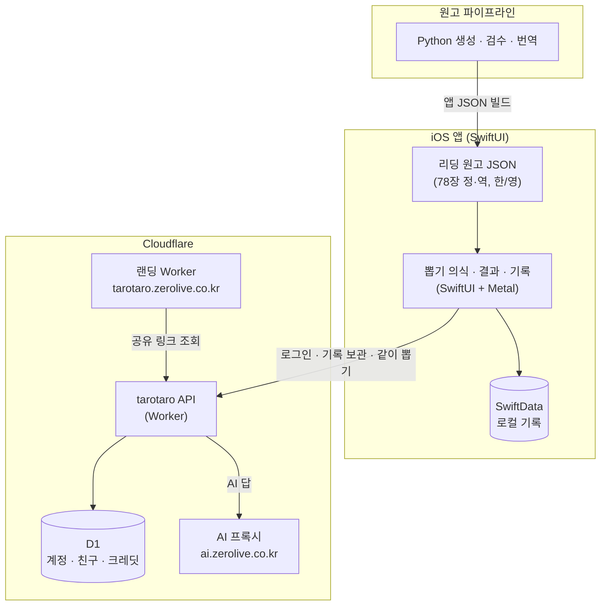

# 햄찌 타로타로

🌐 **Language**: [한국어](./README.md) | [English](./README_EN.md)

> 타로 마스터 햄찌가 카드를 섞고, 펼치고, 뽑은 카드를 상담하듯 길게 읽어 주는 iPhone 타로 앱

---

## 개요

**햄찌 타로타로**(영문 Hamzzi Tarot)는 햄찌 다이어트의 마스코트 햄찌가 타로 마스터가 되어 카드를 읽어 주는 iPhone 타로 앱입니다. 노크 · 흔들어 섞기 · 덱 나누기 · 부채꼴에서 고르기로 이어지는 뽑기 의식을 손으로 거치고, 뽑은 카드는 78장 정·역 원고로 길게 해석합니다. 질문을 적으면 햄찌가 AI로 답하고, 친구와 한 장씩 뽑아 하나의 리딩을 만들 수도 있습니다. 한국어가 원문이고 영어판을 함께 내어 174개 지역에 출시했습니다.

---

## 주요 기능

### 주기별 타로
- 오늘 1장 · 이번 주 7장 · 이번 달 3장(상황·행동·결과) · 올해 12+1장
- 오늘의 메시지는 주제(일반·연애·돈·일)별 900~1,200자, 책처럼 양쪽 정렬한 본문

### 햄찌에게 묻기 · 고민 풀어 보기
- 질문을 적으면 카드를 뽑고 햄찌가 AI로 답변
- 배열 선택: 현재 상황·장애물·조언(3장) · 둘 중 하나(5장, A·B 이름 붙이기) · 할까 말까(3장) · 앞으로의 흐름(3장)
- 햄찌 추천(질문 문장을 기기 안에서 판정) · 직접 고르기 · 햄찌 마음대로 · 설정 기본값

### 뽑는 의식 · 덱 정화
- 노크 세 번, 폰을 흔들어 섞기, 덱 나누기, 부채꼴에서 직접 고르기 — 단계마다 설정에서 끌 수 있음
- 덱 정화: 노크 · 호흡 · 싱잉볼 · 크리스탈 · 달빛 · 재정렬

### 친구 · 같이 뽑기
- 친구와 한 장씩 뽑아 하나의 리딩을 완성
- 친구 찾기, QR 추가, 신고·차단, 서버 금칙어 거르기
- 공유 링크는 앱이 없어도 웹(`tarotaro.zerolive.co.kr`)에서 열림

### 흐름 · 도움말
- 기록 · 흐름 달력 · 저녁 회고 · 이어 묻기(기기 안에서 생성)
- 도움말 세 겹: 햄찌 첫 안내 · 물음표 모드 · 용어 밑줄, 그리고 햄찌한테 물어보기(AI)

### 계정 · 보안
- 회원가입 없이 사용, 친구·AI·구매 때만 Apple · Google · 카카오 로그인
- 로그인하면 기록을 계정에 암호화 보관, 탈퇴 즉시 삭제
- 앱 잠금(Face ID · PIN), iCloud 동기화, 로컬 알림

### 과금
- 구독 햄찌 플러스(월·연, 7일 무료 체험) + AI 호출용 크레딧 묶음
- 보상형 광고로 크레딧 충전, Google AdMob(배너 · 네이티브 · 보상형), UMP 동의 → ATT
- 구독 상태와 크레딧 잔액은 서버가 계정 단위로 보관해 기기를 바꿔도 유지

---

## 기술 스택

| 분류 | 기술 |
|------|------|
| **Frontend** | SwiftUI, SwiftData, Metal 셰이더, iOS 17+ (iPhone 전용) |
| **Backend** | Cloudflare Workers + D1 (계정 · 기록 보관 · 친구 · 결제 확인 · AI 답 · 운영자 화면) |
| **AI** | 자체 프록시 `ai.zerolive.co.kr` 경유 LLM 호출 |
| **Landing** | Cloudflare Workers (소개 · 공유 링크 · 개인정보처리방침 · 원고 검수 퀴즈) |
| **Content** | Python 원고 생성 · 검수(lint) · 번역 스크립트 → 앱 JSON |
| **Monetization** | StoreKit 구독 · 크레딧, Google Mobile Ads (AdMob), UMP · ATT |
| **Auth** | Sign in with Apple, Google, Kakao |
| **Build Tools** | XcodeGen, xcodebuild, Wrangler |

---

## 아키텍처

---

## 개발 과정에서의 도전과 해결

### 1. 해석의 분량과 말투가 곧 제품의 가치
**도전**: 타로 앱은 카드 한 장의 짧은 키워드만 보여 주면 금방 흥미를 잃습니다. 78장 정·역에 주제별 메시지까지 사람이 읽을 만한 원고를 일관된 말투로 갖춰야 했습니다.

**해결**: 원고 원본을 Python 스크립트로 생성·검수·번역해 앱 JSON으로 빌드하는 파이프라인을 만들었습니다. 원고는 lint 규칙(해요체, 결과 장담·속마음 단정 금지)을 통과해야 하고, 랜딩의 `/review` 검수 퀴즈로 사람 검수 결과를 다시 원고에 반영합니다.

### 2. 회원가입 없이도 기록과 구매가 따라가는 계정
**도전**: 가입 장벽 없이 쓰게 하면서도, 친구·AI·구매를 쓰는 순간부터는 기기를 바꿔도 기록과 구독·크레딧이 유지되어야 했습니다.

**해결**: 로그인을 친구·AI·구매 시점으로 미루고, 로그인한 계정의 기록은 서버에 암호화 보관, 구독 상태와 크레딧 잔액은 서버가 계정 단위로 들고 있게 했습니다. 탈퇴 시 즉시 삭제하고, 계정 합치기 실패 시 아무것도 바뀌지 않도록 설계했습니다.

### 3. 뽑기 의식의 손맛
**도전**: 버튼 하나로 카드를 뽑으면 타로 특유의 몰입감이 사라집니다.

**해결**: 노크·흔들어 섞기·덱 나누기·부채꼴 고르기를 실제 손 동작으로 구현하고 애니메이션·햅틱 판정값을 별도 명세로 관리했습니다. 반복 사용자를 위해 각 단계를 설정에서 끌 수 있게 했습니다.

### 4. 사용자 생성 콘텐츠와 심사 대응
**도전**: 친구 찾기와 같이 뽑기는 사용자 생성 콘텐츠로 분류되어 App Store 심사 요건을 충족해야 했습니다.

**해결**: 신고 즉시 차단, 차단 목록, 서버 금칙어 거르기를 넣고, 광고 등급을 연령 등급에 맞췄습니다. 카드 그림 78장은 기존 덱을 베끼지 않고 직접 그려 저작권·상표 문제를 피했습니다.

---

## 역할 및 기여

- 기획 · 기능 명세 · 모션 명세 · UI/UX 가이드 작성
- SwiftUI + SwiftData + Metal 셰이더 iOS 앱 구현
- Cloudflare Workers + D1 서버 API 설계 (계정 무결성 · 친구 · 같이 뽑기 · 결제 확인 · AI 답)
- 리딩 원고 생성 · 검수 · 한/영 번역 파이프라인 구축
- 카드 78장 · 마스코트 · UI 에셋 제작
- 구독 · 크레딧 · AdMob 수익화 구현
- 랜딩 페이지 · 공유 링크 웹 뽑기 · App Store 출시 및 심사 대응

---

## 관련 링크

- **GitHub**: [leonardo204/Hamzzi-tarotaro](https://github.com/leonardo204/Hamzzi-tarotaro) (비공개)
- **App Store**: [햄찌 타로타로](https://apps.apple.com/app/id6825188179)
- **소개 페이지**: [tarotaro.zerolive.co.kr](https://tarotaro.zerolive.co.kr)
- **Contact**: zerolive7@gmail.com

---

*햄찌 타로타로는 손으로 거치는 뽑기 의식과 길게 읽어 주는 해석으로, 타로를 귀엽고 다정하게 즐기도록 돕는 iPhone 앱입니다.*
