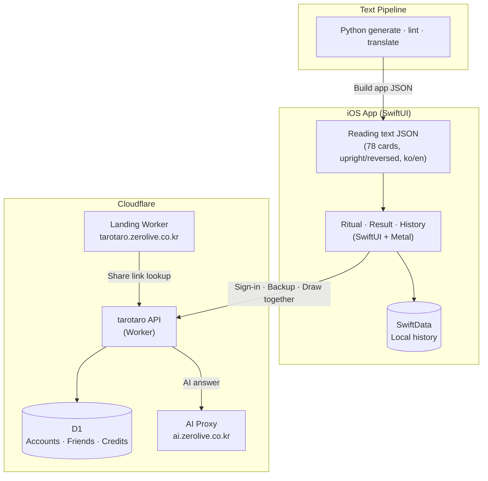

# Hamzzi Tarot

🌐 **Language**: [한국어](./README.md) | [English](./README_EN.md)

> An iPhone tarot app where tarot master Hamzzi shuffles, spreads, and reads your cards at length like a real consultation

---

## Overview

**Hamzzi Tarot** (Korean: 햄찌 타로타로) is an iPhone tarot app in which Hamzzi, the mascot of HamzziDiet, becomes a tarot master. Users go through a hands-on drawing ritual — knocking, shaking to shuffle, cutting the deck, and picking from a fan — and the drawn cards are interpreted at length from upright and reversed texts for all 78 cards. Users can write a question and get an AI answer from Hamzzi, or draw one card each with a friend to build a single shared reading. Korean is the source language with an English edition, released in 174 regions.

---

## Key Features

### Periodic Readings
- Today 1 card · This week 7 · This month 3 (situation · action · outcome) · This year 12+1
- Daily messages of 900–1,200 characters per topic (general · love · money · work), justified like a book

### Ask Hamzzi · Work Through a Worry
- Write a question, draw cards, and Hamzzi answers with AI
- Spreads: situation·obstacle·advice (3) · either-or (5, name A and B) · do it or not (3) · the road ahead (3)
- Hamzzi's pick (question judged on-device) · choose yourself · random · settings default

### Drawing Ritual · Deck Cleansing
- Knock three times, shake the phone to shuffle, cut the deck, pick from a fan — each step can be turned off
- Deck cleansing: knock · breath · singing bowl · crystal · moonlight · reorder

### Friends · Draw Together
- Draw one card each with a friend to complete one reading
- Friend search, QR add, report & block, server-side word filtering
- Share links open on the web (`tarotaro.zerolive.co.kr`) even without the app

### Flow · Help
- History · flow calendar · evening review · follow-up questions (generated on-device)
- Three layers of help: Hamzzi's first guide · question-mark mode · term underlines, plus Ask Hamzzi (AI)

### Account · Security
- No sign-up required; Apple · Google · Kakao sign-in only for friends, AI, and purchases
- Signed-in history is stored encrypted per account and deleted immediately on withdrawal
- App lock (Face ID · PIN), iCloud sync, local notifications

### Monetization
- Hamzzi Plus subscription (monthly · yearly, 7-day free trial) + credit packs for AI calls
- Rewarded ads for credits; Google AdMob (banner · native · rewarded), UMP consent → ATT
- Subscription state and credit balance are held server-side per account and follow device changes

---

## Tech Stack

| Category | Technology |
|----------|------------|
| **Frontend** | SwiftUI, SwiftData, Metal shaders, iOS 17+ (iPhone only) |
| **Backend** | Cloudflare Workers + D1 (accounts · history backup · friends · purchase verification · AI answers · admin) |
| **AI** | LLM calls via in-house proxy `ai.zerolive.co.kr` |
| **Landing** | Cloudflare Workers (intro · share links · privacy policy · text review quiz) |
| **Content** | Python scripts for text generation · lint · translation → app JSON |
| **Monetization** | StoreKit subscriptions · credits, Google Mobile Ads (AdMob), UMP · ATT |
| **Auth** | Sign in with Apple, Google, Kakao |
| **Build Tools** | XcodeGen, xcodebuild, Wrangler |

---

## Architecture

---

## Challenges and Solutions

### 1. Length and Tone of Readings Are the Product
**Challenge**: A tarot app that only shows short keywords per card loses interest quickly. Readable texts in a consistent tone were needed for 78 cards upright and reversed, plus topic-based messages.

**Solution**: Built a pipeline in which Python scripts generate, lint, and translate source texts into app JSON. Texts must pass lint rules (polite friendly tone, no guaranteed outcomes or claims about others' feelings), and human review results from the landing site's `/review` quiz are fed back into the texts.

### 2. Accounts That Carry History and Purchases Without Sign-Up
**Challenge**: The app had to be usable without a sign-up barrier, yet history, subscriptions, and credits had to survive device changes once friends, AI, or purchases were used.

**Solution**: Deferred sign-in to the moment of friends, AI, or purchase. Signed-in history is stored encrypted on the server, and subscription state and credit balance are held per account. Data is deleted immediately on withdrawal, and account merging is designed so that nothing changes if it fails.

### 3. The Feel of the Drawing Ritual
**Challenge**: Drawing cards with a single button removes the immersion unique to tarot.

**Solution**: Implemented knocking, shaking, cutting, and fan picking as real hand gestures, with animation and haptic thresholds managed in a separate spec. Each step can be turned off in settings for repeat users.

### 4. User-Generated Content and App Review
**Challenge**: Friend search and drawing together count as user-generated content and had to meet App Store review requirements.

**Solution**: Added instant block on report, a block list, and server-side word filtering, and aligned the ad rating with the age rating. All 78 card illustrations were drawn originally rather than copied from existing decks to avoid copyright and trademark issues.

---

## Role & Contributions

- Wrote planning, functional spec, motion spec, and UI/UX guide
- Implemented the iOS app with SwiftUI + SwiftData + Metal shaders
- Designed the Cloudflare Workers + D1 server API (account integrity · friends · draw together · purchase verification · AI answers)
- Built the reading text generation · review · Korean/English translation pipeline
- Produced 78 card illustrations, mascot, and UI assets
- Implemented subscription · credits · AdMob monetization
- Landing page, web share-link readings, App Store release and review handling

---

## Links

- **GitHub**: [leonardo204/Hamzzi-tarotaro](https://github.com/leonardo204/Hamzzi-tarotaro) (private)
- **App Store**: [Hamzzi Tarot](https://apps.apple.com/app/id6825188179)
- **Landing Page**: [tarotaro.zerolive.co.kr](https://tarotaro.zerolive.co.kr)
- **Contact**: zerolive7@gmail.com

---

*Hamzzi Tarot helps people enjoy tarot in a cute and gentle way, with a hands-on drawing ritual and readings told at length.*
