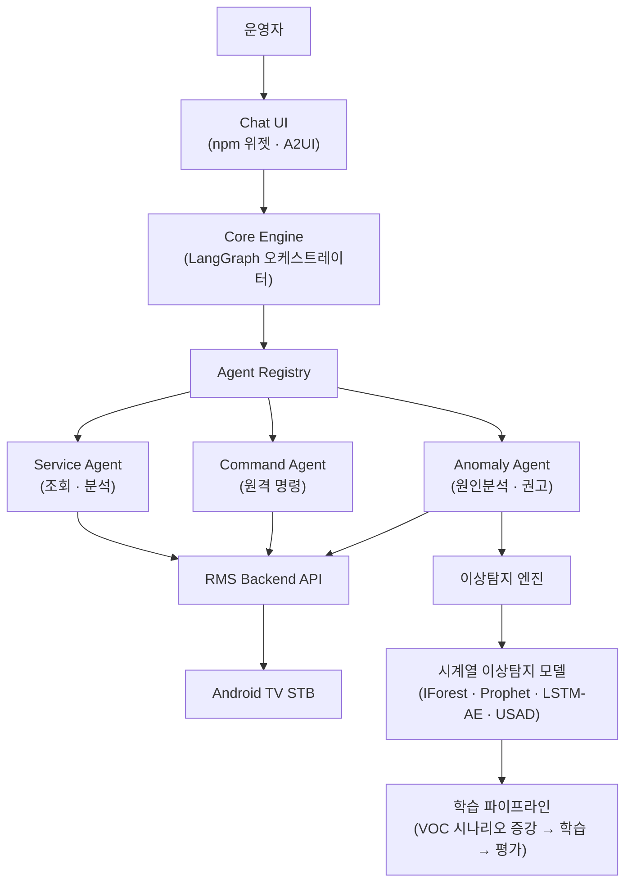

# RMS AI

🌐 **Language**: [한국어](./README.md) | [English](./README_EN.md)

> STB 원격관리 제품의 AI 기능 개발 리딩 — Agentic 챗봇 · 이상탐지 · 제품 AI 방향성

---

## 개요

**RMS**(Remote Management System)는 Android TV 셋톱박스를 원격으로 관리하는 제품입니다. 국내 대형 IPTV 사업자를 대상으로 운영되며, 이 프로젝트는 여기에 AI 기능을 얹는 작업입니다.

운영자가 대시보드를 헤매지 않고 대화로 단말을 다루게 하는 **Agentic 챗봇**, 단말 로그에서 이상 징후를 잡아내는 **이상탐지 모델**, 탐지 결과의 원인을 짚고 조치를 권고하는 **이상탐지 에이전트** — 세 가지를 개발했습니다. 저는 이 세 갈래의 개발 리딩과 함께 RMS 제품 전체의 AI 방향성을 맡았습니다.

2026년 **IBC**(International Broadcasting Convention)에 제품 데모로 출품했습니다.

---

## 담당 역할

| 영역 | 역할 |
|------|------|
| **Agentic 챗봇** | 개발 리딩 — 오케스트레이터 아키텍처 설계, Agent Registry 규격 정의, 팀 리딩 |
| **이상탐지 모델** | 개발 리딩 — 데이터 증강 전략 수립, 시나리오 정의, 모델 선정과 평가 기준 설계 |
| **이상탐지 에이전트** | 개발 리딩 — 그래프 설계, 검증 구조 설계, 확장 구조 설계 |
| **제품 AI 방향성** | RMS 제품 전체의 AI 적용 범위 정의, 고객 대응 문서, 사내 세미나·전시 자료 |

---

## 주요 구성

### 1. Agentic 챗봇

운영자가 자연어로 단말 상태를 묻고, 원인을 분석하고, 원격 명령을 실행하는 챗봇입니다.

- **오케스트레이터** — LangGraph 기반 그래프가 요청을 받아 정책 검사 → 실행 계획 수립 → 도구 호출 → 응답 조립까지 처리하고, 결과를 SSE로 흘려보냅니다.
- **Agent Registry** — Core Engine 안에는 기능 목록이 없습니다. 규격을 지켜 등록한 에이전트만 호출되므로, 코드를 고치지 않고 기능을 붙일 수 있습니다.
- **Route와 Policy** — 한 번의 대화 결과를 실행·되묻기·거부·범위 밖 등으로 나누고, 위험한 명령은 정책이 가로막습니다.
- **Service Agent 분리** — 조회·분석 담당과 명령 실행 담당을 별도 컨테이너로 나눠, 권한과 감사 기준을 다르게 적용했습니다.
- **A2UI 렌더링** — 응답에 화면 구성까지 담아 보냅니다. 챗봇 UI는 npm 패키지로 만들어 기존 RMS 화면에 위젯으로 끼워 넣습니다.

### 2. 이상탐지 모델

고객 불만(VOC) 상위 시나리오를 기준으로 셋톱박스 로그를 증강하고, 시계열 이상탐지 모델을 학습·평가했습니다.

- **VOC 기반 시나리오 설계** — 부팅루프, 리소스 포화, 네트워크 저하, 화면 이상, 스토리지 고갈
- **데이터 증강** — 라벨 데이터와 로그 이력이 없는 상태에서 시작해, LLM 증강과 실측 데이터를 함께 썼습니다.
- **모델 비교** — Isolation Forest, Prophet, LSTM-AutoEncoder, USAD, AutoEncoder, 앙상블을 같은 기준으로 평가했습니다.
- **반복 학습 파이프라인** — 증강 → 학습 → 평가를 목표 점수에 닿을 때까지 돌리고, 라운드별 결과를 기록합니다.
- **검증 기준 정립** — 기능·정확도·데이터·부하 네 가지로 나눈 모델 검증 가이드를 만들어 팀 공통 기준으로 썼습니다.

### 3. 이상탐지 에이전트

탐지된 이상의 원인을 짚고 조치를 권고하는 읽기 전용 에이전트입니다. 판단은 하되 실행은 하지 않습니다.

- **진입점 두 개** — 백엔드가 임계 초과를 감지해 비동기로 부르는 길, 운영자가 챗봇으로 묻는 길.
- **이중 검증** — 계산 결과는 엔진에 다시 물어 대조하고, 추론 결과는 LLM 심판이 다시 봅니다. 둘 다 통과해야 응답합니다.
- **Graceful Fallback** — 검증에 실패해도 무응답으로 끝내지 않고 부분 결과·재시도·사용자 확인으로 내려갑니다.
- **도메인 레지스트리** — 새 이상탐지 항목은 레코드 하나만 추가하면 라우팅과 화면 표현이 함께 따라옵니다.
- **mock ↔ real 전환** — 목 서버와 실 서버 양쪽을 배선해 두고 설정으로 갈아끼웁니다. 전시 데모는 목으로 안정적으로 돌리고, 실 연결은 준비되는 대로 붙입니다.

---

## 기술 스택

| 분류 | 기술 |
|------|------|
| **Language** | Python 3.12, TypeScript |
| **Agent** | LangGraph, LangChain |
| **Backend** | FastAPI, Pydantic v2, SQLAlchemy 2 (async), httpx |
| **Frontend** | React 18, Vite, Zustand, A2UI |
| **ML** | scikit-learn, Prophet, LSTM-AutoEncoder, USAD, pandas / numpy |
| **LLM** | Gemini |
| **Data** | PostgreSQL |
| **Infra** | Docker Compose, AWS, Azure GPU VM |
| **Ops** | LangFuse, MLflow |

---

## 아키텍처

---

## 개발 과정에서의 도전과 해결

### 1. 기능을 늘릴수록 오케스트레이터가 무거워지는 문제

**도전**: 운영자가 요구하는 기능이 계속 늘어나는데, 기능을 챗봇 본체에 직접 넣으면 본체가 비대해지고 팀이 같은 파일을 동시에 고치게 됩니다.

**해결**: Core Engine에서 기능 목록을 걷어내고 Agent Registry를 뒀습니다. 규격을 지켜 등록하면 코드 변경 없이 기능이 붙습니다. 조회·분석과 명령 실행을 별도 컨테이너로 나눠 권한과 감사 기준도 분리했습니다.

### 2. 라벨도 로그 이력도 없는 상태에서 모델을 만들어야 함

**도전**: 이상탐지 학습을 시작할 시점에 라벨링된 데이터가 없었고, 과거 로그도 쌓여 있지 않았습니다.

**해결**: 실제 고객 불만 데이터에서 상위 시나리오를 뽑아 정답의 기준으로 삼고, LLM으로 로그를 증강해 학습 데이터를 만들었습니다. 증강 → 학습 → 평가를 라운드로 돌리며 시나리오별로 목표 점수에 닿을 때까지 반복하고, 실측 데이터가 들어오는 대로 섞었습니다.

### 3. LLM이 틀린 원인을 자신 있게 말하는 문제

**도전**: 원인분석을 LLM에 맡기면 그럴듯하지만 틀린 답을 내놓습니다. 운영자가 그 말을 믿고 단말을 건드리면 사고가 됩니다.

**해결**: 검증을 두 번 넣었습니다. 계산 결과는 엔진에 다시 물어 대조하고, 추론 결과는 별도 LLM이 심판으로 다시 봅니다. 둘 다 통과해야 응답이 나갑니다. 실패하면 무응답 대신 부분 결과나 되묻기로 내려갑니다. 에이전트가 조치를 직접 실행하지 않고 권고만 하도록 범위도 못 박았습니다.

### 4. 전시 데모의 안정성과 실 연동의 진행을 동시에

**도전**: IBC 출품 일정은 고정인데 실 백엔드와 실 이상탐지 엔진은 개발 중이었습니다.

**해결**: 목 서버와 실 서버를 양쪽 다 배선하고 설정으로 갈아끼우는 구조로 만들었습니다. 데모는 목으로 흔들림 없이 돌리고, 실 연결은 준비된 항목부터 하나씩 토글로 붙였습니다. 데이터 소스는 항목별로 목·실을 섞어 쓸 수 있게 했습니다.

---

## 역할 및 기여

- RMS 제품 전체의 AI 적용 범위와 방향 정의
- Agentic 챗봇 오케스트레이터 아키텍처 설계 및 개발 리딩
- Agent Registry 규격 정의 — 코드 변경 없는 기능 확장 구조
- 이상탐지 모델 개발 리딩 — VOC 기반 시나리오 설계, 증강 전략, 모델 선정·평가 기준
- 이상탐지 모델 검증 가이드 작성 (기능 · 정확도 · 데이터 · 부하)
- 이상탐지 에이전트 설계 및 개발 리딩 — 그래프, 이중 검증, 도메인 확장 구조
- 고객 대응 문서 · 설계 산출물 작성, 사내 AI 개발 세미나 진행
- IBC 2026 출품 데모 구성 및 전시 기술 자료 제작

---

## 관련 링크

- **전시**: IBC 2026 출품
- **Contact**: zerolive7@gmail.com

> 사내 프로젝트로 저장소와 상세 설계 문서는 공개하지 않습니다.

---

*RMS AI는 셋톱박스 원격관리 제품에 대화형 운영과 이상탐지를 얹어, 운영자가 화면을 뒤지는 대신 물어보고 판단할 수 있게 만드는 프로젝트입니다.*
