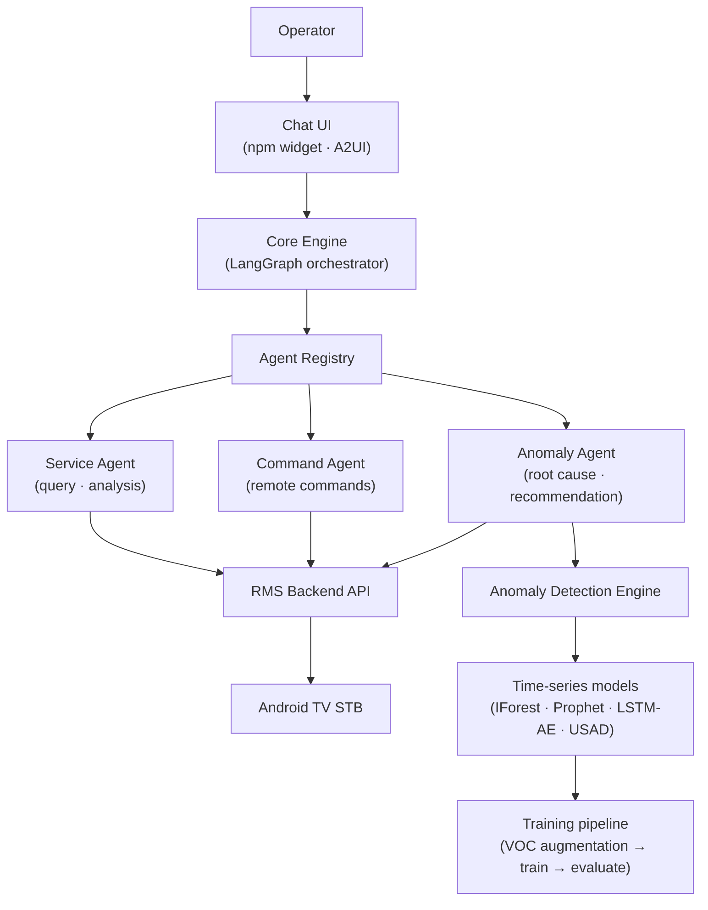

# RMS AI

🌐 **Language**: [한국어](./README.md) | [English](./README_EN.md)

> Leading AI feature development for an STB remote management product — agentic chatbot · anomaly detection · product AI direction

---

## Overview

**RMS** (Remote Management System) is a product for remotely managing Android TV set-top boxes, operated for a major domestic IPTV provider. This project adds AI capabilities to that product.

Three pieces were built: an **agentic chatbot** that lets operators handle devices through conversation instead of navigating dashboards, **anomaly detection models** that catch abnormal signals in device logs, and an **anomaly detection agent** that explains the cause and recommends actions. I led development across all three and owned the AI direction for the RMS product as a whole.

Exhibited as a product demo at **IBC 2026** (International Broadcasting Convention).

---

## My Role

| Area | Role |
|------|------|
| **Agentic chatbot** | Development lead — orchestrator architecture, Agent Registry specification, team leadership |
| **Anomaly detection models** | Development lead — data augmentation strategy, scenario definition, model selection and evaluation criteria |
| **Anomaly detection agent** | Development lead — graph design, verification design, extension design |
| **Product AI direction** | Defined the scope of AI adoption across RMS, customer-facing documents, internal seminars and exhibition materials |

---

## Components

### 1. Agentic Chatbot

Operators ask about device status, analyze causes, and run remote commands in natural language.

- **Orchestrator** — A LangGraph graph handles policy checks → execution planning → tool dispatch → response assembly, streaming results over SSE.
- **Agent Registry** — The Core Engine holds no feature list of its own. Only agents registered against the spec are called, so features can be added without touching code.
- **Routes and policies** — Each turn resolves to execute, clarify, deny, out-of-scope, and so on; risky commands are blocked by policy.
- **Service Agent separation** — Query/analysis and command execution run as separate containers, with different permission and audit rules.
- **A2UI rendering** — Responses carry their own UI layout. The chat UI ships as an npm package embedded into the existing RMS screens as a widget.

### 2. Anomaly Detection Models

Set-top box logs were augmented around the top customer complaint (VOC) scenarios, then used to train and evaluate time-series anomaly detection models.

- **VOC-driven scenarios** — boot loop, resource saturation, network degradation, display anomaly, storage exhaustion
- **Data augmentation** — Started with no labels and no log history; combined LLM-based augmentation with real measured data.
- **Model comparison** — Isolation Forest, Prophet, LSTM-AutoEncoder, USAD, AutoEncoder, and an ensemble evaluated on the same basis.
- **Iterative training pipeline** — augment → train → evaluate, repeated until the target score is reached, with per-round results recorded.
- **Verification criteria** — Authored a model verification guide covering function, accuracy, data, and load, adopted as the team standard.

### 3. Anomaly Detection Agent

A read-only agent that explains the cause of a detected anomaly and recommends action. It judges, but never executes.

- **Two entry points** — an asynchronous call from the backend when a threshold is exceeded, and a natural-language question from the operator through the chatbot.
- **Double verification** — Computed results are re-queried against the engine; inferred results are reviewed by a separate LLM judge. A response goes out only when both pass.
- **Graceful fallback** — A failed check does not end in silence; it degrades to a partial result, a retry, or a question back to the user.
- **Domain registry** — Adding a new anomaly domain takes a single record; routing and chat presentation follow from it.
- **mock ↔ real switching** — Both mock and real backends are wired, selectable by configuration. The exhibition demo runs stably on mocks while real connections are switched on as they become ready.

---

## Tech Stack

| Category | Technology |
|----------|------------|
| **Language** | Python 3.12, TypeScript |
| **Agent** | LangGraph, LangChain |
| **Backend** | FastAPI, Pydantic v2, SQLAlchemy 2 (async), httpx |
| **Frontend** | React 18, Vite, Zustand, A2UI |
| **ML** | scikit-learn, Prophet, LSTM-AutoEncoder, USAD, pandas / numpy |
| **LLM** | Gemini |
| **Data** | PostgreSQL |
| **Infra** | Docker Compose, AWS, Azure GPU VM |
| **Ops** | LangFuse, MLflow |

---

## Architecture

---

## Challenges and Solutions

### 1. The orchestrator grows heavier with every new feature

**Challenge**: Operator requests kept expanding. Putting each feature directly into the chatbot core would bloat it and force the team to edit the same files at once.

**Solution**: Removed the feature list from the Core Engine and introduced an Agent Registry. Anything registered against the spec joins without a code change. Query/analysis and command execution were split into separate containers so permission and audit rules could differ.

### 2. Building models with no labels and no log history

**Challenge**: When anomaly detection work started there was no labeled data, and no historical logs had accumulated.

**Solution**: Derived the top scenarios from real customer complaint data as the basis for ground truth, and generated training data by augmenting logs with an LLM. Augment → train → evaluate ran in rounds until each scenario hit its target score, mixing in real data as it arrived.

### 3. LLMs stating wrong causes with confidence

**Challenge**: Leaving root cause analysis to an LLM produces plausible but wrong answers. An operator acting on one of those touches a live device.

**Solution**: Added two verification steps. Computed results are re-queried against the engine and compared; inferred results are reviewed by a separate LLM acting as judge. Only results passing both are returned. On failure the agent degrades to a partial result or a clarifying question. The agent's scope was also fixed to recommendation only — it never executes an action itself.

### 4. Keeping the demo stable while real integration was still in progress

**Challenge**: The IBC schedule was fixed, but the real backend and the real detection engine were still under development.

**Solution**: Wired both mock and real sources and made them switchable by configuration. The demo ran on mocks without wobble, and real connections were toggled on one by one as they became ready. Data sources can mix mock and real per domain.

---

## Role & Contributions

- Defined the scope and direction of AI adoption across the RMS product
- Designed the agentic chatbot orchestrator architecture and led its development
- Specified the Agent Registry — feature extension without code changes
- Led anomaly detection model development — VOC-driven scenarios, augmentation strategy, model selection and evaluation criteria
- Authored the model verification guide (function · accuracy · data · load)
- Designed and led the anomaly detection agent — graph, double verification, domain extension structure
- Produced customer-facing documents and design deliverables; ran internal AI development seminars
- Built the IBC 2026 demo and its exhibition technical materials

---

## Links

- **Exhibition**: IBC 2026
- **Contact**: zerolive7@gmail.com

> An internal company project — the repository and detailed design documents are not public.

---

*RMS AI brings conversational operation and anomaly detection to a set-top box remote management product, so operators can ask and decide instead of digging through screens.*
